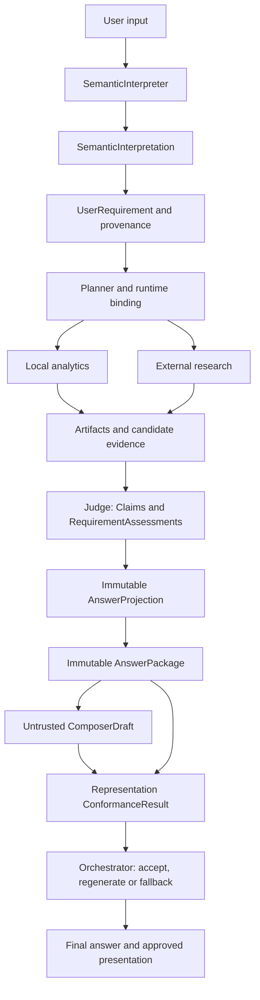

# Baseball Agent

**An evidence-governed MLB analytics and research agent, with an explicit path from
user intent to supported answers.**

Baseball questions often combine statistics, changing facts and explanations. A query
returning rows—or a model producing fluent prose—does not prove that the question was
answered. Baseball Agent makes those boundaries inspectable: preserve the user's
obligations, plan work, compute or acquire evidence, verify its scope and lineage,
and only then compose an answer.

This is an independent clean-room Python implementation with a React interface.
**Architecture Baseline v1** documents the post-Naming-Refactor implementation. It is
an engineering/research prototype, not a production-ready service or a claim of
universal query coverage, unmeasured accuracy or guaranteed source availability.

## Implemented capabilities

- Chinese/English semantic interpretation, contextual entity references, multi-turn
  follow-ups and backend-owned clarification.
- User-owned Requirements distinct from Planner work items, with provenance,
  source-clause conservation and finite derivation checks.
- Read-only PostgreSQL and historical Parquet/DuckDB analytics: canonical metric
  packs plus catalog-validated Safe IR, deterministic SQL compilation and
  requested-versus-executed conformance receipts.
- External research with source representations, replayable spans/structured fragments,
  typed evidence verification, bounded content resolution and shared safe acquisition.
- Judge-only factual Claims and Requirement-local partial-result retention; independent
  supported work can survive an unresolved sibling without claiming Goal completion.
- Finite governed derived operations with exact-cell operands and recursive ancestry.
- Immutable Judge projection and response package, untrusted Composer drafts,
  independent representation conformance and bounded regeneration/fallback.
- FastAPI REST/SSE with generated TypeScript contracts, Zod validation and trusted
  React tables/charts. The backend—not the browser—owns semantics and approval.

## Architecture



This is a conceptual flow, not a literal call graph. `Engine.ask` owns the runtime;
Planner selects work, Binder resolves exports, Judge approves factual material, and
Orchestrator owns bounded continuation/presentation lifecycle. Conformance checks
faithfulness to approved material, **not original factual truth**.

## Engineering contributions

The central work is in semantic and authority boundaries, not just model prompting:
source-bound obligations, independent execution receipts, structural measure
verification, partial-result independence, exact subject/output granularity,
recursive derived-operation proofs, deep immutable snapshots and contract-tested
frontend/backend interaction. The project uses custom orchestration rather than a
framework-controlled authority graph; no LangChain/LangGraph integration is claimed.

### Technology stack

- **Backend:** Python, Pydantic, FastAPI/Uvicorn, OpenAI-compatible model client,
  HTTPX, BeautifulSoup, SQLGlot, pytest.
- **Storage/computation:** PostgreSQL/psycopg2, DuckDB/Parquet, SQLite conversation
  persistence; bounded subprocess computation.
- **Frontend:** React 19, TypeScript, Vite, Tailwind, TanStack Query/Table, Recharts,
  OpenAPI-generated types, Zod, Vitest and Playwright.

## Local setup and execution

Use Python **3.14** and Node **24+** for the documented development baseline
(the available environment is Python 3.14.4 / Node 24.21.0). A broader Python
compatibility matrix is not established. Dependencies and scripts are defined in
[`requirements.txt`](requirements.txt) and [`frontend/package.json`](frontend/package.json).

```bash
# From the repository root
python3 -m venv .venv
source .venv/bin/activate
python -m pip install -r requirements.txt
cp .env.example .env
```

Edit `.env` locally; never commit credentials:

- Set `DEEPSEEK_API_KEY` (or `OPENAI_API_KEY`) and the compatible provider base URL/model
  as needed. Runtime defaults are in [`app/config.py`](app/config.py).
- Configure an existing read-only PostgreSQL analytics source with `POSTGRES_*`,
  and/or set `PARQUET_ARCHIVE_PATH` to **your own** directory of
  `mlb_statcast_<year>.parquet` files. Replace the path placeholder in `.env.example`
  with your local archive directory. Private datasets and database provisioning are not included.
- The catalog expects the verified Statcast tables/columns and supported source windows;
  an arbitrary baseball database is not automatically compatible. Offline fallback
  is useful for tests, not equivalent to real-model query coverage.

```bash
python -m app.cli doctor                    # probes configured sources
python -m app.cli chat                      # interactive conversation
python -m app.cli dev --trace-level verbose # same runtime, added diagnostics
python -m app.cli ask "Show Shohei Ohtani's 2023 regular-season batting statistics"
```

These commands match the CLI/configuration; no live data/provider success is asserted
by this documentation cycle. `doctor` itself connects to sources. Conversation state
is stored under `.runtime/` by default; private runtime evidence stays out of Git.

For the web UI, run these in separate shells:

```bash
# Repository root
python -m uvicorn app.api.main:app --reload --host 127.0.0.1 --port 8000
```

```bash
cd frontend
npm ci
npm run dev
```

Open `http://127.0.0.1:5173/conversation/new`; Vite proxies `/api` to port 8000.
OpenAPI UI: `http://127.0.0.1:8000/docs`. Keep provider/database credentials on the
backend, never in `VITE_*` variables. These are local development servers, not an
authenticated public deployment. See [frontend development](docs/architecture/FRONTEND_LOCAL_DEVELOPMENT.md).

## Testing and maturity

Latest **historical Naming Refactor** validation:

| Check | Result |
|---|---|
| Backend | **4184 passed, 63 skipped** |
| Frontend | **10 passed** |
| Production frontend build | **Passed** |
| Focused live smoke | **5 passed** |
| OpenAPI | **5 paths / 35 schemas**, byte-identical to the pre-refactor baseline |

**Full live integration was not rerun after Naming Refactor.** These totals are not
new documentation-cycle test results. See [Testing and Validation](docs/engineering/TESTING_AND_VALIDATION.md)
for current checks and how to run the relevant suites without confusing offline,
fixture-backed and real-provider evidence.

```bash
python -m pytest tests -q
# Explicitly opt into real LLM/data/network tests when intended:
RUN_INTEGRATION=1 python -m pytest tests/test_integration_live.py -v
# Frontend checks:
cd frontend
npm test
npm run build
```

## Known limitations and next steps

- **U-1:** English per-player paraphrases can be rejected by source review.
- **U-2:** Split per-player requests fail closed before execution.
- **F-3/F-5:** Multi-subject analytical capabilities remain incomplete; scoped
  subject-cell proofs are not universal comparison/ranking coverage.
- **F-4:** Forecast execution is limited; prediction research is not a general
  forecasting engine.
- Finite measures/operations/source windows and bounded scalar derived roots;
  no arbitrary query/model support or invented unavailable baseball metrics.
- Public source/provider/network restrictions and real-model variability affect
  discovery, semantic acceptance and response wording. No paywall or credential bypass.
- Goal-wide research quotas/deadline enforcement and full retrieval cache remain
  planned; local limits and budget metadata are not M3 completion.
- Artifacts and SSE replay are not durable across process restart; turns are serialized
  per Engine. No safe token streaming, formal retraction, cancellation protocol or
  production multi-user authentication/scaling is claimed.

See [Implementation Status](docs/engineering/IMPLEMENTATION_STATUS.md) and
[Next Steps](docs/roadmap/NEXT_STEPS.md). This baseline cycle does not begin UAT or
framework integration.

## Documentation index

| Topic | Document |
|---|---|
| Architecture and subsystem map | [Architecture Overview](docs/architecture/ARCHITECTURE_OVERVIEW.md) |
| Scheduling, clarification and retries | [Control Flow](docs/architecture/CONTROL_FLOW.md) |
| Receipts, evidence and lineage | [Data and Provenance Flow](docs/architecture/DATA_AND_PROVENANCE_FLOW.md) |
| Decision ownership | [Authority Model](docs/architecture/AUTHORITY_MODEL.md) |
| Exact symbols and semantic identity audit | [Domain Concept Registry](docs/architecture/DOMAIN_CONCEPT_REGISTRY.md) |
| Naming policy / compatibility history | [Naming Conventions](docs/architecture/NAMING_CONVENTIONS.md), [Refactor Map](docs/architecture/NAMING_REFACTOR_MAP.md) |
| Implemented versus planned | [Implementation Status](docs/engineering/IMPLEMENTATION_STATUS.md) |
| Evidence and check commands | [Testing and Validation](docs/engineering/TESTING_AND_VALIDATION.md) |
| Decisions and original records | [Design Decisions](docs/engineering/DESIGN_DECISIONS.md), [ADRs](docs/adr/README.md) |
| Detailed contracts | [SPEC](docs/SPEC.md) |
| Frontend wire/presentation boundary | [Frontend Foundation](docs/architecture/FRONTEND_INTERACTION_FOUNDATION.md) |
| Future scoped work | [Next Steps](docs/roadmap/NEXT_STEPS.md) |

Historical audit and milestone documents remain original evidence, not current
implementation promises. Repository-wide agent guidance is in [AGENTS.md](AGENTS.md).
