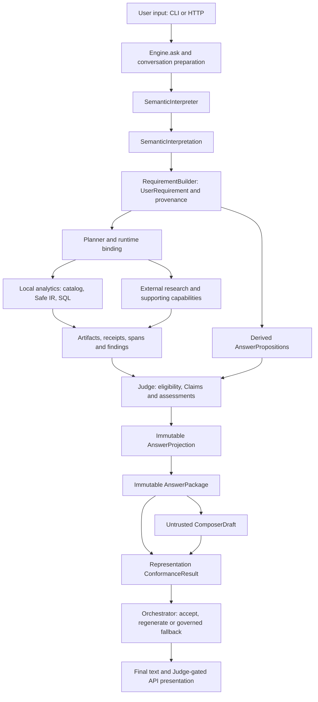

# Architecture Overview — Baseline v1

Implementation reference: `1d8cb3ad0ec786b48c82de830c6ad68b229c1511`.
This baseline follows the behavior-preserving Naming Refactor. It documents a
research/engineering prototype, not production readiness or universal query coverage.

## One runtime, explicit governance

The system answers MLB questions using local Statcast computation and external
research. Open-world language proposes meaning; deterministic grounding constrains
privileged execution and factual commitment. A single custom Python runtime coordinates
plain capabilities. There is no LangChain/LangGraph runtime or independent multi-agent
authority graph.

This is conceptual **data flow**, not a literal method call chain. `Engine.ask`
calls the interpreter, builder and plan loop, then creates `Orchestrator` for final
Judge/lifecycle management. The Orchestrator can request one justified post-Judge
continuation through Engine; it does not wrap or replace all pre-Judge scheduling.
`ResponseComposer.compose` delegates production draft/review policy to that same
Orchestrator. Clarification/no-composable-content/provider-failure paths may render
the governed package directly, without creating a successful draft.

## Implementation map

| Subsystem | Owner and main contracts | Implemented decisions and actual limits |
|---|---|---|
| Interpretation | `app/semantic/interpreter.py`, `goals.py`; `SemanticInterpretation`, `AnalysisRequest`, `EvidenceRequest`, `RelationSemantics`, `EvidenceIntent` | Bilingual/model-assisted interpretation, stable knowledge context, bounded schema repair, exact source spans, semantic candidates and residue. Finite fallback/source-review machinery remains; model variability and valid-language rejection are not eliminated. |
| Obligation authority | `app/semantic/provenance.py`, `clarification.py`; analytics `authority.py`, `derivations.py` | Current-user ancestry, context/clarification deltas and finite derivation validation. Quote/digest and parent IDs prove ancestry, not semantic entailment. Planner metadata cannot originate obligations. |
| Planning / execution lifecycle | `app/planner/planner.py`, `app/runtime/engine.py`, `binder.py`, `orchestrator.py` | Need graph, deterministic criticality, typed binding, scoped failure, converter insertion, bounded pre/post-Judge retries. Two domain families coexist with seven registered/Planner-visible capability specs; infrastructure migration is not a two-tool-only implementation. |
| Local analytics | `app/capabilities/analytics/` | Canonical batting/pitching metric packs or bounded model-proposed `AnalyticalQuery`; validate, compile, guard, execute read-only, attest measures and independently compare requested/executed meaning. Canonical does not bypass authority/conformance. Arbitrary SQL and arbitrary operations are not supported. |
| Storage | `AnalyticalExecutor`, `PostgresExecutor`, `DuckDBExecutor`; `PersistenceStore` | PostgreSQL hot source and historical Parquet via DuckDB; catalog maps differing physical names and routes windows. Availability is observed, not a shared transaction snapshot. SQLite persists conversations/Goals/clarification, not durable artifacts or run events. No bundled private database/archive or provisioning pipeline. |
| Derived computation | `OperationContract`, `GovernedOperation`; `OperationAdmission` | Tool may propose exact cells; Judge-side trusted evaluation replays finite operations and recursively admits parents to conformant DB scalar roots. Free Python/AST safety alone grants no factual authority. Filtered/grouped/window roots and arbitrary forecast models are outside the current proof surface. |
| External acquisition | `WebResearchTool`, `AgenticContentResolver`, `app/web/transport.py` | One research capability with internal providers, English-first query planning, relationship ranking, bounded retrieval, native representations and lazy/structured evidence. URI proposals return through safe acquisition. Transport destination/redirect/body restrictions remain; active browser networking is unavailable (`render_public_page` returns `JS_RENDER_REQUIRED`). Full M3 Goal-wide quotas/deadlines/cache are **not** implemented. |
| Evidence / Judge | `EvidenceFinding`, `EvidenceAssessment`, `ArtifactAssessment`, `RequirementAssessment`, `Claim` | Replay/signature/scope/source-role/temporal gates; bounded inspection of already acquired context; native current-team admission; Requirement-local support and Goal-level completion. Source review is bounded; current-team records do not prove injuries or historical membership. |
| Answer generation | `AnswerProjection`, `AnswerPackage`, `ComposerDraft`, `ConformanceResult` | Judge freezes nested governed state on return. Response builds detached immutable navigation; independent representation assessment is bound to package/draft digest. Up to two drafts, then governed fallback. Consistency is presentation telemetry, never a post-answer status writer. |
| Shared Knowledge | `KnowledgeStore`, `KnowledgeItem` | ACTIVE stable aliases/definitions support interpretation; candidate approval remains explicit. `knowledge_class` derives from type; mutable facts cannot silently become current factual Claims. No universal external-fact memory. |
| HTTP / browser | `app/api/`; `frontend/src/` | FastAPI commands and replayable in-process SSE; React/TypeScript, OpenAPI types and Zod, trusted tables/charts. Backend owns meaning. One approved text delta, not token streaming; one Engine lock, no durable replay/cancel/retraction protocol or production auth. |

Historical source coverage figures are not current availability guarantees. Run
`python -m app.cli doctor` in the configured environment; receipts record actual
coverage. PostgreSQL and Parquet are read-only analytical inputs, not the application's
conversation database. DuckDB uses an in-memory connection with archive-directory
configuration; this is not a claim of a newly audited filesystem sandbox.

## Separate views and sources of truth

- [Control flow and retry lifecycle](CONTROL_FLOW.md)
- [Data and provenance flow](DATA_AND_PROVENANCE_FLOW.md)
- [Authority model](AUTHORITY_MODEL.md)
- [Exact domain symbols and identity audit](DOMAIN_CONCEPT_REGISTRY.md)
- [Verified implementation status](../engineering/IMPLEMENTATION_STATUS.md)
- [Testing and this cycle's validation](../engineering/TESTING_AND_VALIDATION.md)
- [Decision index and original ADRs](../engineering/DESIGN_DECISIONS.md)
- [Next steps / unresolved utility backlog](../roadmap/NEXT_STEPS.md)

[SPEC](../SPEC.md) remains the detailed contract reference; older milestone sections
include accepted targets, not automatic implementation claims. The status document
and code determine what is implemented at this baseline. Historical ADRs/audits are
preserved, including superseded vocabulary and past validation totals.
