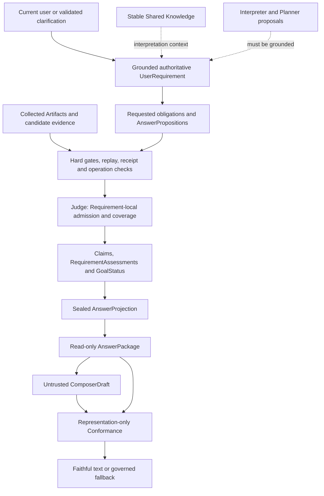

# Authority Model

**Approval is Requirement-local; completion is Goal-level. The Judge alone approves
final factual Claims.** Names, schema validity and provenance cannot manufacture authority.

Dashed edges are proposals/context, not independent sources of user obligation or
factual truth. Lifecycle policy may request another upstream evaluation; it may not
edit a sealed result to make presentation easier.

## Non-collapsible boundaries

| Boundary | Why it must remain |
|---|---|
| Requirement != PlannerNeed | `UserRequirement` preserves what the user needs; `PlannerNeed` selects work and dependencies. Need hints/constraints cannot create requested truth. |
| Artifact != approved evidence | Tool status and export usability permit bounded processing/binding. Judge rechecks exact requested semantics, lineage, admissibility and proof before using material factually. |
| EvidenceFinding != Claim | A span-specific verification may be insufficient, irrelevant or contradicted. Only Judge-admitted support can become a factual assertion. |
| RequirementAssessment != GoalStatus | Per-obligation authority/support/coverage differs from overall completion. Every mandatory child matters; one supported child cannot satisfy a compound parent. |
| AnswerProjection != AnswerPackage | Judge's governed result differs from detached response navigation/citation/context input. The latter cannot recompute current completion policy. |
| AnswerPackage != ComposerDraft | Approved input versus untrusted proposed language. Citation/label metadata is not self-certification. |
| ComposerDraft != approved answer | Missing/malformed/mismatched independent review drops unassessed prose and triggers regeneration or governed fallback. |
| AnalyticalConformanceResult != presentation ConformanceResult | Requested versus executed analytical meaning is different from presentation faithfulness to already-approved material. Neither replaces the Judge. |
| QualifiedEvidence != Claim | Useful material is shown only with its structural limitation; it cannot increment coverage or turn a Goal COMPLETE. |
| Provenance != entailment | Bound quote/digest, parent IDs, operation labels and model proof prose show origin, not correctness of semantic transformation. |

## Decision owners and allowed changes

- **Semantic/Requirement backend:** Interpret → Ground → Clarify. Preserve mandatory
  clauses, unknown residue, original wording and resolution history. Derived authority
  requires validated finite transformations, not inference labels alone. Stable knowledge
  assists meaning; mutable facts re-enter Artifact/evidence/Judge governance.
- **Planner:** chooses evidence work, not completion. Runtime derives criticality from
  served Requirements/dependencies. Capability acceptance and canonical identity contracts
  override an incompatible Planner input preference.
- **Evidence processing:** proposes span meaning and source role; deterministic gates
  check requested expectations and acquired-source grounding. Hard conflicts cannot be
  upgraded by a semantic reviewer. `ArtifactAssessment` is Judge-local eligibility data,
  not a second Claim governor.
- **Judge:** rebinds authority and current Requirements; admits independent conformant
  units, aggregates mandatory child coverage, approves Claims/qualifications, sets status
  and seals the whole result immediately. Selective source inspection is bounded and
  never acquires new material. There is no production `Judge.reconcile_expression`.
- **Orchestrator:** bounds fresh Judge integrity recovery, justified acquisition
  continuation, Composer regeneration, consistency repair and fallback. Cannot mint facts.
  A structural failure can remove authority in a detached governed fallback, not invent it.
- **Composer:** untrusted synthesis/presentation only. Labels FACTUAL/QUALIFIED/ANALYSIS/
  LIMITATION do not license claims. Nonfactual synthesis is still independently reviewed
  for representation; absent review does not authorize free prose.
- **Conformance / consistency:** check expression against the approved package/Claims.
  Conformance may repair text and report violations; consistency records presentation
  telemetry. Neither mutates factual support, Requirement coverage or GoalStatus.
- **API / frontend:** display only backend-projected results, submit user text or opaque
  clarification choices. No browser interpretation of entities, measures, filters,
  qualification, independence, approval or completion; no executable model-generated UI.

## Partial and incomplete outcomes

`CoverageState` is proposition-level; `RequirementStatus` is per Requirement;
`GoalStatus` is overall. `TEMPORARILY_UNRESOLVED` belongs to semantic clause resolution,
not any new Goal status. `PARTIAL` appears in evidence/artifact/coverage and reserved
public presentation vocabulary; the Judge uses `LIMITED` for incomplete investigated
work and `WAITING_FOR_USER` when clarification is pending.

A COMPLETE Goal requires all mandatory propositions SATISFIED under governed rules.
LIMITED can also reflect investigated-but-unresolved work, qualified support or permitted
background; it does **not** guarantee at least one approved factual Claim. This follows
`verification.coverage.goal_status` and Judge's continuation handling.

Independence must come from governed Requirement/partition/dependency contracts, not
Goal membership or task-word heuristics. Valid A survives independent unresolved B;
A dependent on B remains blocked. A compound split cannot be replaced by a simpler
supported subset. For multiple subjects, input membership does not authorize output
pooling: individual units need their own scoped scalar or inspected grouped row.
POOLED is descriptive, not authority for sums/means/ranks. Known U-1/U-2 and F-3/F-5
utility gaps remain in [implementation status](../engineering/IMPLEMENTATION_STATUS.md).

## Review limits

The identity audit found no confirmed material collision of domain contracts. It did
find stale documentation and accepted-target/implementation gaps. This statement does
not resolve the functional backlog, prove universal semantic conservation, or assert
`wrong semantic COMPLETE = 0` beyond historically evaluated corpora. No behavior or
language rules were changed in this documentation cycle.
