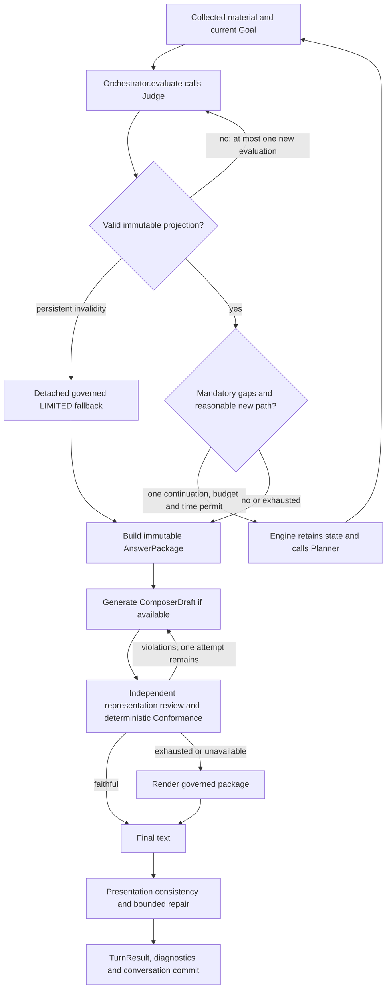

# Control Flow and Retry Lifecycle

Baseline v1 follows [`Engine.ask`](../../app/runtime/engine.py), not a hypothetical
framework call graph. Domain vocabulary: [registry](DOMAIN_CONCEPT_REGISTRY.md).

## Entry and pre-Judge work

1. CLI and FastAPI ultimately call `Engine.ask(session_id, text)`. Ingress validation
   precedes conversation preparation. The API serializes Engine turns with one lock.
2. `ConversationManager.prepare` classifies independent/follow-up/clarification/revision
   context. The interpreter proposes meaning; contextual entity merging happens before
   Requirement construction. Independent-turn contamination is stripped.
3. `RequirementBuilder.build` binds original clauses, temporal anchor, ancestry and
   grounded operations/reporting. `build_propositions` refines answer obligations;
   propositions never schedule work. A validated pending analytical clarification can
   instead produce a revised Goal through `apply_semantic_delta`.
4. `_run_plan` asks `Planner.plan` for Needs, validates the graph, derives criticality,
   adds necessary identity prerequisites, then `_execute_pending` resolves dependencies
   through `RuntimeBinder`. Missing required bindings block the Need, not the whole Goal.
5. A typed export mismatch may insert one converter for that consumer via
   `_repair_conversion`; `artifact_projection` records row selection and lineage rather
   than pretending a statistical result is a search query. Capability execution returns
   `CapabilityResult` containing artifact(s) and `ToolOutcome`.
6. Outcomes and material remain available to recovery planning. Need SATISFIED means
   work produced usable material; it is not Requirement SATISFIED.

## Final governance and presentation

The repeated arrows have hard bounds; there is no open-ended self-correction loop.
The same package instance is supplied to Composer and reviewer for each composition
attempt; a new Judge pass creates a **new** projection/package, not a mutation.

## Actual bounds and retained state

| Layer | Current bound / stop condition | State retained / caveat |
|---|---|---|
| Semantic request schema repair | At most two logical interpreter calls, second with schema feedback | Unresolved schema remains material ambiguity; provider/client attempts are a separate accounting dimension. |
| Initial planning | `max(2, min(MAX_ROUNDS or 4, 5))` calls in `_run_plan`; normal default 4 | Stops on core support, no recovery need or no new work. Config `MAX_NEEDS` defaults to 8; this is not a global network-call budget. |
| Pending execution | Guard < 20 passes; at most one typed converter repair per consumer per invocation | Dependencies, artifacts, bindings and typed outcomes; unprogressable core Needs block, supporting Needs cancel. |
| Analytics IR construction | Canonical query first when applicable; otherwise up to 3 IR candidates with validation feedback | Requested contract is already bound. No candidate executes on unresolved obligations. |
| Analytical resolution | Goal stores `analytical_resolution_state`, clause identity and attempts | Duplicate unresolved attempts are suppressed without materially changed semantic/identity/capability context. TEMPORARILY_UNRESOLVED is clause state, not GoalStatus. |
| Judge integrity | One fresh evaluation after structural inconsistency | Prior invalid snapshot is not edited; persistent invalidity routes to detached limited fallback. |
| Post-Judge acquisition | At most 1 continuation; one Planner call; mandatory unresolved assessment, available untried acquisition family/retryable path, Need room and elapsed time < 45 seconds | Initial Needs/outcomes/artifacts and semantic ledger retained. The 45-second launch guard is **not** a hard end-to-end cancellation deadline. |
| Judge source inspection | Default `max_inspections=2` | Already acquired source context only; no new acquisition or reopening hard conflicts. |
| Composition | At most 2 draft attempts (initial + 1 regeneration), independently reviewed | Typed violation feedback only, up to 16 kinds; same governed package. Provider failure still counts as an attempt. |
| Consistency | Deterministic check, bounded repair/recheck, then package fallback | Telemetry on `TurnResult`; no mutation/downgrade of Judge coverage/status. |

`GoalResearchBudget` is currently a type/observability contract, not an enforced shared
runtime quota. Retrieval has local limits and transport bounds; do not attribute full
Goal-wide reservation/cancellation/cache behavior to the runtime (see
[implementation status](../engineering/IMPLEMENTATION_STATUS.md)).

## Clarification and partial-result lifecycle

Analytical options are backend-defined DISCHARGE_RESIDUE / PRESERVE_RESIDUE /
REPLACE_INTERPRETATION actions tied to Goal/Requirement/candidate/source span and
target digest. Stale targets fail closed. Arbitrary free text is not itself an action;
a typed proposal needs backend confirmation, with repeated clarification bounded.
Other contextual clarification resumes through the existing conversation path.

Within a Goal/replan, independent supported Requirement units keep their material;
dependent unresolved meaning blocks the corresponding result. A clarification revision
creates/links a revised Goal and does not imply durable artifact carry-over. SQLite
persists conversation/Goals/context/clarification; full artifact replay across restart
is not implemented. The frontend retains previously approved cards in its in-memory
state; it does not independently approve, retract or recompute them. A formal
artifact-retraction event remains deferred.
