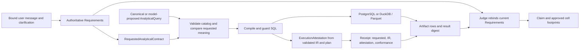
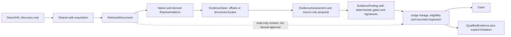

# Data and Provenance Flow

This view complements [control flow](CONTROL_FLOW.md) and
[authority flow](AUTHORITY_MODEL.md). A reference/hash shows origin or identity; it
is not semantic entailment, source independence or factual approval.

## Analytical lane

`LocalAnalyticsTool.execute` binds requested obligations **before** IR generation.
Canonical metric packs and model candidates use the same validation/conformance
boundary. Measures are attested structurally, not inferred from column labels.
The receipt keeps requested meaning, validated IR, execution hints, attestation and
its digest, conformance and result digest. Scope/provenance/enumeration accompany
material. A row, empty scalar, successful SQL or tool `ACCEPTED` does not prove the
requested result. `SourceAvailability` is an observed coverage receipt, not a global
transaction snapshot or a permanent source-coverage guarantee.

PostgreSQL uses a read-only role/transaction and statement timeout. DuckDB queries
archive Parquet through an in-memory connection and configured archive directory.
Catalog routing handles physical schema differences; one SQL query is not an
arbitrary cross-source union. Cross-artifact computation is separately governed.

### Derived factual ancestry

`OperationContract` owns requested operation/parameters/operand scope; tool-proposed
`GovernedOperation` owns exact artifact/export/row/field coordinates.
`OperationAdmission.assess` reconstructs the contract, recursively admits derived
parents, rebinds root cells to conformant database receipts, evaluates the finite
operation with trusted code and checks exact output/export equality. Proofs retain
ordered operands, root scopes/units, result/attestation identities and replay digest.
Cycles, ambiguous identities, mismatched output, unknown/unbounded ancestry and
unsupported root shapes reject admission. Bounds include depth 64, 1,024 inspected
cells, 256 roots and 1 MB proof retention.

Current operations are SUBTRACT, SUM, RATIO, MEAN, RANK, AGGREGATE, MIN, MAX,
MEDIAN and PERCENT_CHANGE with finite parameter rules. Roots are complete singleton
scalar aggregates, not arbitrary grouped/filtered/window computations. The older
`GlobalOperation` plus `EnumerationContract` decides whether input populations may
combine; it is **not** the Requirement-local factual `OperationContract`.
AST-safe Python or a replayable program alone does not prove output dependency or
requested analytical meaning.

## External evidence lane

Text replay requires the exact representation/body substring and hash linkage;
structured replay uses the representation identity, JSON pointer and canonical
fragment. Findings bind span hash and proposition signature; nested admitted records
must resolve to persisted artifact collections. A search title/snippet cannot become
body evidence. Native records retain provider response identity/raw fields/observation
time; current-team data cannot establish another predicate or historical interval.

`AgenticContentResolver` can derive a traceable view from one acquired representation
or propose a URI, under AST/process/depth/attempt limits. It cannot fetch directly,
create a finding or approve support. URI candidates return to safe acquisition.
`RetrievedDocument` is the implemented ContentArtifact; there is no second resource
contract named ContentArtifact.

### Shared Safe Transport

[`app/web/transport.py`](../../app/web/transport.py) is used by web search,
fetch ladder, Tavily and dynamic facts. Each destination/redirect passes
`web_search._pinned_target`; original Host/TLS SNI are retained, environment proxy
use is disabled, cross-origin redirects strip non-negotiation headers, POST redirects
and HTTPS downgrade reject. Raw delivery, bounded gzip/deflate decoding, retained
bytes and attempts are measured. The code documents bounded socket read-ahead rather
than pretending wire bytes stop exactly at the policy limit.

Acquisition restrictions are intentional: no credentials/paywall bypass, arbitrary
internal URLs, unrestricted model network access or guarantee of browser/provider
reachability. The optional browser configuration is **not** active browser acquisition:
`fetch_ladder.render_public_page` returns `JS_RENDER_REQUIRED` until networking can
obey the shared hard bounds. Model-provider LLM transport is a separate client.
This baseline does not re-audit those controls.

## Provenance into the answer and browser

`RequirementProvenance` binds user message/digest/span, authoritative parents or
validated clarification. `EntityReference` separately carries surface form, canonical
identity, namespace, antecedent and verification level. `OriginLineage` /
`PropositionOrigins` describe evidence-local dependencies; outlet count never proves
independent corroboration or changes coverage.

Judge returns a detached recursively immutable `AnswerProjection`.
`build_answer_package` creates a second **intentional presentation representation**:
full governed Requirements/assessments/propositions/Claims/qualifications plus
Requirement navigation, citation markers and bounded context. Context is not approval
of a whole source. SHA-256 `package_id` and exact `draft_identity` bind the independent
representation assessment. Conformance checks expression, not original world truth.

API `present` publishes inert `AnswerView`/`PresentationArtifact`, not raw artifacts.
Database tables require a Judge Claim referencing the exact artifact. Subject-only
and reporting-only tables apply approved row/field footprints; the adapter caps
public rows at 500 and excludes SQL, IR, receipts and arbitrary nested payloads.
TypeScript generated types and Zod validate the wire; they do not grant factual
approval. Public `PARTIAL` is reserved; current GoalStatus is COMPLETE, LIMITED,
FAILED or WAITING_FOR_USER.

## Persistence and retention

- SQLite `PersistenceStore`: conversation JSON, messages, Goals/Requirements, accepted
  context and pending clarification. It does not persist full Tool artifacts,
  AnswerPackages or API run/event replay.
- Runtime artifacts retain evidence collections/receipts in memory for that execution.
  In-process SSE replay is lost on API restart; previous approved UI cards are not a
  durable evidence store.
- Diagnostics are metadata-minimized, credential-scrubbed and permission-restricted;
  they are not a copy of fetched bodies or a public debugging endpoint. Default
  expiry is seven days; restricted research mode is still metadata-only and expires
  after 24 hours. Cleanup occurs on recorder writes, not an always-running janitor.
- Shared Knowledge seed/ACTIVE files and candidate-review records are distinct from
  mutable factual evidence. Approval into a knowledge registry is not current-world
  Claim approval.
